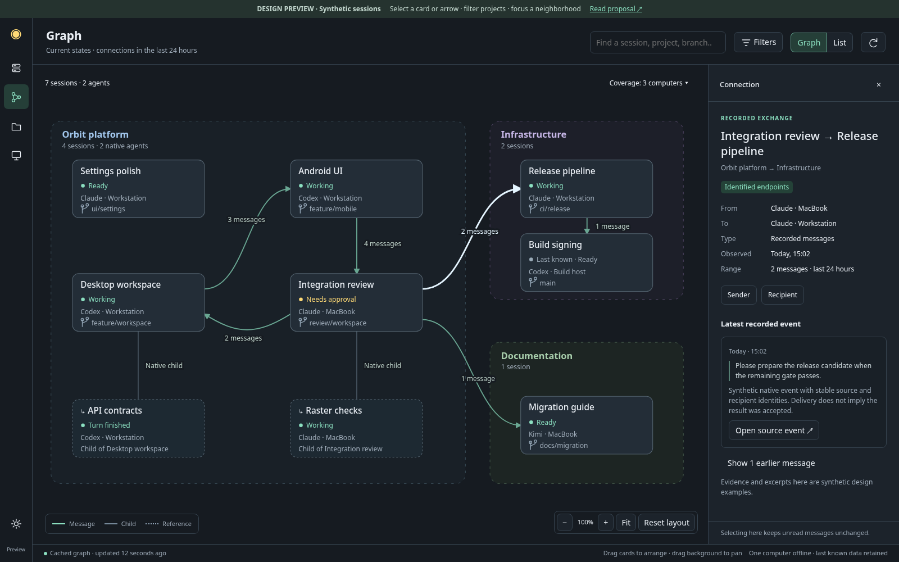

# Session and agent graph

Date: 2026-10-15. Status: proposed product and technical design, not shipped.
Design task: zerus-4rkz. Source audit: `669101d2`.
Interactive, synthetic preview: [Graph workspace](../../../design/session-graph/index.html).



## Purpose

Make **Graph** a main workspace destination beside Sessions and Projects. It
answers: which agents are working together, across which projects and computers;
what was actually exchanged; where a person needs to act; and how to get to the
right conversation without reconstructing the collaboration from chat history.

The owner's scope is all sessions and their connections, including communication
across projects. A session with no known connections must still be discoverable.
The graph is a live view over existing work, not a new place to start or own it.
Opening, filtering or selecting the graph must not send input, start agents,
acknowledge questions, mark messages read or create worktrees.

## Reference and interpretation

Read Hanako's public [Loops and Graphs article](https://x.com/hanakoxbt/status/2091515787366306154),
published 2026-08-23. X's page returned 403; the article's full public text was
retrieved through its [FxTwitter representation](https://api.fxtwitter.com/hanakoxbt/status/2091515787366306154).
The author's [course landing page](https://agent-layers.vercel.app/) was also
checked. Authenticated course lessons were not accessed.

The useful distinction is between verification within a bounded job and
coordination between jobs. Dependencies require an actual result crossing a
boundary; parallel work, verification and return-for-correction need explicit
meaning. Our observed session graph should preserve those distinctions. It
should not label every message a dependency or every idle worker a completed job.

The initial design below is Zerus-specific. Executable workflow graphs, automatic
delegation and verification gates are a later, separate product extension.

## User journeys

1. **Understand current work.** Open Graph and immediately see the cached fleet,
   project groups, current work and attention states. Select an agent to see its
   immediate collaborators and children. Open its existing Activity when needed.
2. **Follow a handoff.** Select an arrow between a review session and an
   implementation session. See direction, time, delivery evidence and the linked
   source event. Open that event or either endpoint's Activity.
3. **Follow work across projects.** Filter to one project; retain its external
   neighbors as clearly labeled context. An infrastructure session helping two
   projects remains one node, not two copies or a renamed member of both groups.
4. **Find a stalled collaboration.** Filter Needs attention, inspect a pending
   approval or an explicitly declared wait, then open the existing guarded action.
   Silence alone never becomes a fabricated blocker.
5. **Recover context later.** Reopen the same selection, zoom, groups and positions.
   Inspect a past exchange and archived endpoints without replacing present state
   with an invented historical reconstruction.

## Navigation and screen structure

- Add **Graph** to the existing left navigation rail, directly after Sessions.
  Use the established icon system with three linked nodes and a `Graph` tooltip.
  Reuse the workspace, not a separate modal window.
- Sessions and Projects gain **Show in Graph**. The former opens the selected
  conversation and its one-hop neighborhood; the latter applies the project
  scope while retaining outside collaborators. **Back to Graph** restores the
  prior camera and selection after opening Activity.
- Keep the main header to one ordinary row: title, search, scope summary,
  **Filters**, last refresh/coverage and Refresh. A second row appears only for
  active filter chips. No permanently expanded matrix of filtering controls.
- The center takes all remaining space. Bottom-corner controls: zoom, Fit,
  Center selection and Reset layout. A compact legend explains relation types.
- A resizable inspector opens on selection; desktop target width 320–440 logical
  pixels, with real inner margins and independent scrolling. It never squeezes
  the graph into a thin strip: at narrow window widths it becomes an overlay
  drawer. Closing it keeps the selection. It does not contain a second composer.
- A **List** switch presents the same scoped nodes and relations as keyboard- and
  screen-reader-accessible rows. This is also the fallback when the canvas would
  be too dense. Filtering and selection are shared between both representations.

### Initial scope

Default: **All current sessions**, all configured accessible computers/projects;
message relations within the **last 24 hours**. Parent and fork structure is not
removed by this event-time filter. Ready, paused and disconnected known sessions
remain included; Active is an optional filter using the existing shared contract.
Archives are opt-in, except archived endpoints required to explain a visible edge.
Completed native children collapse under their parent by default, consistently
with Sessions; attention, unknown children and local drafts remain discoverable.

Time choices: 1 hour, 24 hours, 7 days, retained history, custom range. Changing
the range filters evidence, not the current status of a session. The header says
`Current states · connections in the last 24 hours`. Historical status replay is
not part of the first version.

Show counts with their scope: `34 sessions · 12 agents · 8 outside this project`.
Never describe a bounded page as the whole fleet. Excluded categories and
unloaded groups have visible counts or `unknown`, with a path to expand them.

## Visual language

### Nodes

Use small readable cards, not anonymous dots. At normal zoom a card has:

- session title, with the native provider icon;
- existing state text and a small state marker;
- project and computer context, plus a distinct branch icon before branch text;
- a compact child count or attention badge where relevant.

The title, branch and computer must have different hierarchy. Paths, full IDs,
model settings, current tool and timestamps belong in the inspector. Hover gives
the complete clipped title; full titles are also accessible to keyboard focus.
Do not put live timers or scrolling tool output on every card.

Native agents are smaller cards with a child marker and their recorded role/name.
Parent and child retain independent state. One-shot children can open history
without presenting unsupported Send/Resume actions. Provider profile aggregates
with unknown identities stay a labeled aggregate, not several invented agents.

At overview zoom, collapse to project cards and aggregate connections. At medium
zoom show session cards; at close zoom show the expanded children and selected
relation labels. Attention and coverage remain legible at every level.

### Groups and layout

Projects are subtle labeled regions using existing project colors. Machine
identity is a compact badge, not another mandatory nesting level. Offer grouping
by Project, Computer or None. Unassigned is a real group.

Start with deterministic placement within groups. A child's default position is
near its parent; interproject bundles use clear routes between group boundaries.
Do not run an endless force simulation. New nodes occupy free space near relevant
neighbors; existing positions and the user's camera stay still. Dragging pins a
position locally. Reset layout is explicit and reversible through Back.

Communication cycles are normal. The session graph is a directed multigraph,
not a DAG. The two directions of a conversation have separate counts/evidence
in the inspector even when the overview renders one shared route with two arrows.
Collapsed group edges show aggregate counts; expansion reveals their endpoints.

### Relations

| Relation | Visual and direction | Required meaning |
| --- | --- | --- |
| Parent / delegated child | Thin neutral connector, parent to child | Verified native parent/child identity; persistent structure |
| Message / result transfer | Solid mint arrow, sender to recipient | Recorded exchange with identified endpoints; click for evidence |
| Fork | Thin branching connector, origin to new conversation | Confirmed native fork lineage; not delegation or continued identity |
| Referenced conversation | Dotted neutral arrow, containing message to referenced conversation | Exact parsed reference only; optional layer, never counted as a sent message |
| Waiting for result | Dashed amber arrow, waiting session to expected producer | Later: explicit scoped declaration with a clear settlement event |
| User annotation | Dotted connector labeled Manual | Later: authored note, visibly different from observed facts |

Color is redundant with line pattern, arrow and text. Amber remains meaningful
for attention/explicit waits, not merely high traffic. No permanent blinking,
particles or pulsing edges. Optional brief arrival highlighting obeys reduced
motion and is disabled under load. Repeated messages aggregate by endpoints/type,
not one line per message. Inspection reveals each distinct event without deduping
different messages that happen to have equal text.

## Selection and useful actions

Single click selects a node/edge and opens its inspector. Hover highlights its
one-hop neighborhood without rearranging the graph. **Focus neighborhood** hides
unrelated nodes temporarily, with a persistent exit control. A project filter
keeps cross-project neighbors by default; **Only this project** is explicit and
reports the hidden external links. Search matches sessions, projects, computers,
branches and exact IDs. Results can reveal a node outside the current filter.

Node inspector: identity, project/computer/branch, state and freshness, current
goal if actually reported, children, connections and recent evidence. Primary
action **Open Activity**; secondary **Focus connections**, **Copy reference** and
capability-appropriate existing menu actions. Selecting a graph item is not
permission to send, approve, terminate or archive. Opening Activity reuses its
ordinary viewport/dwell-based read semantics; the graph itself does not read-mark.

Edge inspector: `Sender → Recipient`, relation kind, evidence strength, time range,
unique message count, delivery state and paginated events. Fetch message bodies
only on demand through the original authorized history route. **Open source
event** seeks its exact native/history identity; if it was pruned, say so rather
than opening a same-named replacement. A submitted message is not proof of a model
reply, consumption or task completion.

Keyboard: Tab through controls, list and inspector; arrow navigation among graph
neighbors; Enter opens details; an explicit Open Activity action navigates;
Escape leaves focus mode or closes the inspector; standard zoom and Fit controls.
Reserve any global shortcut only after checking the keyboard-shortcut design.
Touch: pan/pinch, tap to inspect; no hover-only information or tiny edge-only
targets. A selectable relation list complements canvas hit targets.

## What current source really provides

| Existing source | Reusable evidence | Gap / qualification limit |
| --- | --- | --- |
| `tray/src/FleetState.*`, `HgsClient.*` | Known sessions, host reachability and retained stale snapshots | Name/route is not durable conversation identity |
| `tray/src/SessionOrganization.*`, `src/swarm/catalog.rs` | Logical project IDs, colors, memberships and cross-machine folders | Current membership must not rewrite historical event attribution |
| `src/session_reference.rs` | Machine UUID, route, conversation/run, archive and child reference resolution | Mobile enrollment/route ID is not the native machine UUID |
| `src/state/native_subagents.rs`, `claude_subagents.rs`, `subagents.rs` | Provider-owned child IDs, parent identity, tracking evidence and scoped history | Capabilities differ; profile groups do not identify individual children |
| `src/state/fork.rs`, `resume_input.rs` | Recorded fork origin and native child binding | Fork is a new conversation, not a rename |
| `src/state/journal.rs` | Event sequence, subagent reports, Claude `peer_message` origin | Some peer envelopes retain only `sender` text; multiple envelopes can be summarized together |
| `src/state/input.rs` and provider delivery adapters | Guarded target/run, durable request ID and submission receipts | The generic input request has no structured verified source conversation |
| `services/mobile/zerus_mobile/fleet.py` | Authorized gateway/direct-peer machine routing | Multiple routes must not create multiple nodes for one native machine |
| Relay `protocol.rs` and Python `context.py` | Strict API v1 operations, capabilities and retention classes | Graph reads require an additive explicitly scoped protocol feature |

There is no single complete, provider-neutral communication ledger in the audited
source. Existing messages can be visible in Activity without supplying enough
identity for a trustworthy graph edge. Native child structure is much more
complete. Do not promise complete historic communication reconstruction.

## Identity and evidence contract

Internally, a node is a conversation, displayed as a session. Its key is native
machine UUID + provider/account namespace + native conversation identity; a child
adds its verified parent key and provider-native child identity. Accounts are a
namespace where the provider requires them, not a heuristic based on labels.
Provider-scoped child generations must also be retained where IDs can be reused.
If a child has its own verified native conversation and is also independently
listed, alias both observations to one node and retain the parent relation. Never
merge a child with another conversation from an ID/name resemblance alone. A
conversation with multiple live bindings keeps those bindings distinct for actions;
opening or acting revalidates the selected exact run.
Before a native conversation exists, use machine + verified run as a provisional
key. Upgrade that key only through confirmed binding evidence and retain an alias
for cached positions and pending responses. Rename/resume/archive preserve identity
when the underlying conversation is unchanged; Clear/Fork create distinct nodes.

Names, SSH aliases, paths, project IDs, relay enrollment IDs and Beads task IDs
are labels or routing context, never substitute conversation keys. A missing
endpoint becomes an unresolved evidence item; it cannot be attached to today's
same-named session. Stable known but unavailable endpoints can be muted boundary
nodes. Only configured verified routes can open them.
Project membership uses the accepted logical catalog; conflicts or unavailable
catalog data remain explicit. A filter may reveal only endpoints the current
workspace is authorized to see. It never discovers or contacts an arbitrary host
from a message or an external link.

Each normalized event should carry:

```
schema, event_id, origin_machine, origin_epoch, origin_sequence
kind, source_endpoint?, target_endpoint?, occurred_at?, observed_at
request_id?, native_event_id?, source_locator, delivery_state?
evidence_kind, endpoint_resolution, project_at_event?, supersedes?
```

Use stable source event identities for idempotent ingestion. If the same exchange
is observed at both endpoints, correlate only by a verified shared request/native
ID; do not merge by text, time proximity or names. Preserve separate observations
when correlation is unknown and avoid displaying their sum as an exact message
count. `event_id` never changes when delivery status or resolution improves.
Sequence orders one origin; wall clocks are display hints across computers.
Skew and missing timestamps must not invent a total causal ordering.

Evidence levels are explicit: verified native relationship, verified delivery
receipt, source-reported unresolved attribution, exact reference, user annotation.
Endpoint verification and delivery state are separate dimensions. A verified
sender does not mean the recipient consumed the message. Plain pasted XML, a
quoted session name or an agent's prose assertion is not authenticated provenance.

## Collection and persistence

Add a small host-owned relationship index beside existing state, using SQLite
already in the CLI. Store typed metadata and pointers, not duplicate transcripts
or attachments. Keep a schema/epoch, source cursors, tombstones, projection
revision and per-source coverage. Prefer a derived index that can be rebuilt;
new structured send provenance belongs in the durable delivery receipt before it
is projected. Index failure must not trigger another native send.
Proposed default retention is 30 days of exchange metadata with a configurable
local bound; retain current structural relations and aggregate coverage separately.
Pruning exposes its oldest retained date and never deletes source conversation
history. The UI's retained-history range means exactly that available window.

Collection has three paths:

1. Native adapters project proven parent/fork facts and typed communication events.
   Preserve each peer-message envelope independently before presentation combines
   them. Provider support is declared, with missing capabilities visible.
2. Zerus-mediated agent sends acquire optional structured source identity from a
   validated running binding, correlated with the existing request receipt. An
   environment variable or caller-provided source string alone is insufficient.
   Desktop/mobile human input is not mislabeled as agent-to-agent traffic.
   Cross-host sends require explicit validated origin forwarding; unsupported old
   hosts retain ordinary sending and report missing graph attribution.
3. References in public recorded message content can supply the optional reference
   layer. Never execute command snippets or scan arbitrary private tool output to
   guess sender identity. External coordination systems, including memory buses,
   need opt-in adapters with scoped evidence; installation of a plugin alone is
   not permission to ingest all its projects.

Initial bounded backfill indexes available native relationships and recent known
events. It is resumable and reports coverage by machine/provider/time. No
all-history parse on every graph open or every polling tick. Provisional starting
budget: 50 ms projection work / 2 MiB ordinary source input per slice; one bounded
oversize row follows the existing source-reader policy instead of silently
skipping evidence. Benchmark and adjust these targets before implementation freeze.

Proposed read-only API: `hgs graph snapshot --json` and
`hgs graph changes --after <opaque-cursor> --json`, with bounded query scope and
event detail pagination. These commands do not exist yet. Replies include schema,
origin UUID/epoch, revision, nodes, relations, coverage, deletions, continuation
and reset-required state. Limits are server-enforced; partial pages do not delete
unseen nodes. Unsupported hosts return a capability result, never an empty-success
graph. Event locators resolve through existing exact conversation guards.

Desktop composes verified host projections. The mobile path adds an advertised
read-only operation to both strict relay and connector validation, direct-peer
allowlisting, payload bounds, authorization and read-retention bookkeeping. Do
not change a persisted SQL partial-index predicate without a reviewed migration.
Keep API v1 compatibility; do not export an arbitrary session directory as a
single unbounded fleet payload. No graph database/server dependency is proposed.

Concurrent owner-approved work `zerus-nbzl` is replacing the Python connector with
a Rust crate under `services/mobile/connector`, sharing the relay protocol library.
The source table above describes the audited baseline. Implement the future graph
mobile contract in the accepted connector architecture at that time; coordinate
with that migration and its golden-vector/black-box contracts rather than creating
a competing connector design or changing its durable request journal.

## Freshness, caching and failure states

Persist a bounded device-local last-good projection and local view state, scoped
to the authenticated workspace and verified machine identity. Cache timestamps,
coverage and schema with the data. Reopen it immediately, then refresh in the
background. Keep positions, selection and inspector scroll on incremental updates.

- Reuse fleet status updates; do not poll every node independently.
- While visible, coalesce graph deltas and refresh changed hosts at most once per
  2–5 seconds; back off offline hosts. Refresh on relevant delivered events,
  session lifecycle or project membership changes. Hidden views stop detail work.
- Hourly bounded reconciliation catches missed events; it does not clear the
  graph or refetch all bodies. Refresh requests fresh deltas, not cache erasure.
- Show last successful per-host refresh in coverage details. After two seconds of
  a pending request show the existing small yellow loader by that host, retaining
  the last-good graph. Keep errors in fixed status/inspector space, never insert a
  banner that shifts the canvas.
- Distinguish `No recorded connections`, `Loading connections`, `Partly indexed`,
  `Unsupported on this computer`, `Offline — last seen …` and `History unavailable`.
  A successful empty result is different from a missing result.
- Offline does not imply stopped; stale state must not be shown as current work.
  A missing partial page does not mean deletion. Reset/rebuild preserves view
  identity until a replacement projection is complete.

Forget/removal follows existing ownership semantics. Prune the local derived
node/content references on an authoritative deletion; retained counterpart evidence
may say unavailable, but may not silently rehydrate forgotten content. Removing a
machine/workspace clears its local cache and cannot leave another identity's data
under a reused route. Global erasure across independently retained histories is
not implied by a local cache purge.

## Implementation shape and performance

Propose `SessionGraphModel`, `GraphController`, `GraphPage`, custom node/edge items,
an inspector and a shared accessible relation-list model. Connect `GraphPage` to
the existing `SessionsWindow` page stack and navigation, reusing FleetState,
organization and exact session navigation. Replace raw page indices with named
identifiers within affected navigation wiring to avoid shifting existing pages.

Use Qt Widgets' [Graphics View](https://doc.qt.io/qt-6/graphicsview.html) for the
first desktop implementation: it already supports custom items, selection and
view transforms. This fits the current native application without requiring the
optional WebEngine plugin. Use lightweight paint items, cached labels and viewport
culling; avoid a QWidget or rich document per node. Layout/delta preparation runs
off the UI thread, applied with generation guards. Benchmark before adding any
layout library; deterministic grouped placement is sufficient for the first pass.

Provisional acceptance budgets, measured on reference Arch and Mac hardware:
cached first paint under 150 ms; selection response under 100 ms; p95 pan/zoom
frame under 16.7 ms for 250 expanded nodes / 750 aggregate edges; no main-thread
task above 50 ms; bounded cache target 32 MiB of metadata. A 2,000-session / 10,000-
relation fixture must remain usable through grouping, pagination and the list,
not by rendering all detailed cards. Distinguish network latency from rendering.
These are goals, not measured claims about the HTML preview.

Stable ordering, camera, local pins and IDs must survive ordinary refreshes and
restarts. Automatic level-of-detail must not make the focused node disappear.
Publish at most ten visual delta batches per second; prioritize input over
background collection and avoid continuous animation when nothing changed.

## Android and larger future scope

Desktop is the first full spatial workspace. The backend contract should serve
Android from the start, but desktop delivery does not imply mobile support is
already deployed. Android's **Graph** destination uses a neighborhood-first view,
pinch/pan and a bottom-sheet inspector; the equivalent list is always available.
Avoid squeezing the entire desktop inspector/filters onto a phone. Reuse 48 dp
interaction targets and normal accessibility font scaling.

Later explicit work relations can add requested/reviewed/returned result status,
artifact pointers and scoped waits. A Beads adapter can link known task IDs to
sessions while keeping task ownership/dependencies in Beads. Shared task or file
membership alone must never become a communication arrow. Manual annotations
are durable authored metadata with conflict semantics, separate from observations.

An executable workflow editor would require separate WorkUnit/Run/Gate models,
budgets, cancellation, permissions, idempotent dispatch, failure/recovery rules and
reviewed native contracts. Sessions can execute many work units; one workflow node
cannot simply be a session card with a Play button. The observed graph must remain
useful before any orchestration engine exists.

## Delivery boundaries and acceptance

**First usable release:** main Graph destination, all-session inventory, project
groups/cross-project neighbors, native children and fork lineage, verified observed
communication, edge evidence, Activity navigation, cache/freshness, list alternative
and honest partial coverage. Structured provenance for new Zerus-mediated sends is
part of the data work, not postponed until after a decorative canvas ships.

**Following releases:** wider native/external event coverage, explicit wait/handoff
metadata and history browsing; Android parity on the deployed read contract;
workflow authoring only after a separate owner-reviewed specification.

Qualify at least these synthetic scenarios before product delivery:

- Two same-named sessions on different machines; rename, resume, archive, restore,
  clear, fork, provisional identity upgrade and account-scoped child collisions.
- Cross-project and cross-machine exchanges; two routes to one machine; unknown
  sender; unavailable endpoint; mixed peer envelopes and equal-text distinct sends.
- Duplicate/out-of-order events, delivery uncertainty, clock skew, partial pages,
  cursor reset, old CLI/connector, disconnect/reconnect and authoritative deletion.
- Working/Background/Scheduled/attention/Ready transitions retain existing
  semantics; idle is not completed, read-only inspection never clears unread.
- Project filtering keeps external collaborators; unconnected sessions are
  reachable; large groups disclose coverage; refresh never moves a pinned node.
- macOS/Arch/Windows input, trackpad/keyboard, light/dark, high DPI, long titles,
  large text, narrow window, accessible list and reduced motion.
- Existing sending, approval, lifecycle, drafts, Sessions and Projects remain
  intact. A graph/index failure does not replay input or restart an agent.

The interactive preview demonstrates proposed layout, scoped search, external
neighbors, relation details, focus mode and cached refresh using synthetic data.
It does not implement the index, native navigation, actual sends or a workflow
engine. Product code, dependencies, live state and installed clients are unchanged.
